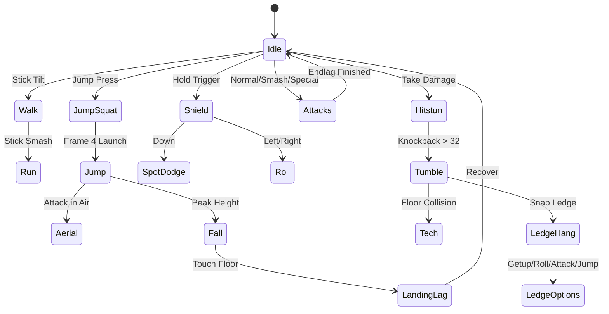

# 🎮 Super Smash Bros Clone: Complete Technical & Game Design Bible

Welcome to the definitive reference manual for the platform fighter clone in `/workspace/muiltplayergame`. This document details the character archetypes, full animation requirements for asset creation, and mathematical mechanics specifications to deliver an authentic, competitive platform fighter experience.

---

## 1. Character Roster & Archetype Profiles

Each character is engineered around signature combat archetypes from the Super Smash Bros series, tuned with distinct weight classes, frame data speeds, and signature gimmicks.

```
+---------------------------------------------------------------------------------------------------+
| CHARACTER       | ARCHETYPE       | INSPIRATION | WEIGHT | RUN SPEED | SIGNATURE GIMMICK              |
+---------------------------------------------------------------------------------------------------+
| Brawler         | All-Rounder     | Mario       | 98     | 6.8       | Bouncing Fireballs, Fair Spike |
| Space Ace       | Rushdown/Fast   | Fox         | 77     | 9.2       | Frame 1 Reflector, Up-Smash KO |
| Swordmaster     | Spacing/Footsie | Marth       | 90     | 7.6       | Blade "Tipper" Sweetspot       |
| Thunder Striker | Agile Zoner     | Pikachu     | 79     | 8.4       | Terrain-Hugging Jolts, Agility |
| Titan Dragon    | Super Heavy     | Bowser      | 135    | 6.2       | Tough Guy Armor, Heavy Smashing|
+---------------------------------------------------------------------------------------------------+
```

---

### Character 1: The Brawler (Mario Archetype)
- **Role**: All-Rounder / Combo Starter.
- **Attributes**: Medium weight (98), medium fall speed, high aerial maneuverability.
- **Combat Style**: Balanced frame data that rewards stringing tilts into aerial juggles.
- **Signature Moves**:
  - **Neutral Special (Fireball)**: Bounces along terrain, applies chip damage and disrupts approaches.
  - **Side Special (Cape)**: Deflects enemy projectiles and reverses opponent facing direction.
  - **Up Special (Super Jump Punch)**: Multi-hit rising punch with coin/spark effects; strong vertical recovery.
  - **Down Special (Cyclone Spin)**: Multi-hit spinning strike; button mashing grants slight vertical lift.
  - **Forward Air (Fair Dunk)**: 16-frame startup windup followed by a devastating downward meteor spike.

---

### Character 2: Space Ace (Fox Archetype)
- **Role**: Rushdown / Fast-Faller / Glass Cannon.
- **Attributes**: Lightweight (77), blazing ground speed (9.2), rapid fall acceleration (fast faller).
- **Combat Style**: Relentless neutral pressure, overwhelming close-range frame data, and high-risk/high-reward recovery.
- **Signature Moves**:
  - **Neutral Special (Blaster)**: Rapid-fire lasers that deal chip damage without triggering flinch or hitstun.
  - **Side Special (Illusion Dash)**: Instant horizontal teleport burst across the stage.
  - **Up Special (Fire Rocket)**: 24-frame charging startup, then multi-directional rocket thrust.
  - **Down Special (Reflector / Shine)**: Frame 1 active barrier that reflects projectiles, knocks away nearby enemies, and can be jump-cancelled.
  - **Up Smash**: Iconic backflip kick with vertical launch power (KO tool at ~90%).

---

### Character 3: Swordmaster (Marth Archetype)
- **Role**: Spacing / Footsies / Disjoint Specialist.
- **Attributes**: Medium-light weight (90), fluid ground mobility, high vertical jump arc.
- **Combat Style**: Relies on disjointed sword hitboxes and the **Tipper Mechanic**:
  - *Sweetspot (Tip of the blade)*: 1.7x damage, 1.9x knockback, crisp high-pitch metallic chime.
  - *Sourspot (Hilt/Base of the blade)*: Low damage and knockback, used for combo extensions.
- **Signature Moves**:
  - **Neutral Special (Shield Breaker)**: Chargeable forward thrust designed to pop full shields instantly.
  - **Side Special (Dancing Blade)**: 4-step branching sword combo with high, neutral, and low slash variations.
  - **Up Special (Dolphin Slash)**: Frame 5 invincible rising vertical slash.
  - **Down Special (Parry Counter)**: Defensive stance that retaliates with 1.4x the opponent's incoming attack power.

---

### Character 4: Thunder Striker (Pikachu Archetype)
- **Role**: Agile Zoner / High-Mobility Combo Fiend.
- **Attributes**: Light weight (79), low profile hurtbox, quick ground and air acceleration.
- **Combat Style**: Uses terrain-hugging projectiles to control space and follows up with multi-hit aerial strings.
- **Signature Moves**:
  - **Neutral Special (Thunder Jolt)**: Electrical orb that clings to stage geometry and drops down walls.
  - **Side Special (Skull Bash)**: Chargeable rocket headbutt launch.
  - **Up Special (Quick Attack)**: Two-phase agile teleport dash capable of snapping to stage or ledge from two sharp angles.
  - **Down Special (Thunder Bolt)**: Vertical lightning bolt summoned from the sky; striking oneself creates a radial electric shockwave.

---

### Character 5: Titan Dragon (Bowser Archetype)
- **Role**: Heavyweight Juggernaut / Grappler.
- **Attributes**: Super-heavy weight (135), slowest walk speed, massive hitboxes, high survival threshold.
- **Signature Gimmick**: **Tough Guy Super Armor** (ignores flinch from weak multi-hit attacks dealing $\le 6\%$).
- **Signature Moves**:
  - **Neutral Special (Fire Breath)**: Continuous flamethrower cone that exhausts fuel over time.
  - **Side Special (Flying Slam)**: Command grab leaping high into the air and crashing down; trajectory can be steered.
  - **Up Special (Whirling Fortress)**: High-speed spinning shell; exceptional Out-of-Shield (OOS) reversal option.
  - **Down Special (Bowser Bomb)**: High-impact ground pound that exerts heavy shield pressure.

---

## 2. Animation Master List (Asset Creation Guide)

To animate each character in 2D (sprite sheets) or 3D (rigged models), implement the following standardized animation states. Each state specifies recommended frame length at 60 FPS, loop behavior, and keyframe cues.



### A. Locomotion & Neutral States
1. **Idle / Neutral Stance**: 40–60 frames, looping. Subtle breathing rhythm, weight shifting, alert combat posture.
2. **Walk Start / Loop / Stop**:
   - *Start*: 4 frames transition.
   - *Loop*: 24–32 frames looping. Steady marching cadence.
   - *Stop*: 6 frames deceleration.
3. **Dash / Initial Run**: 8–12 frames. Explosive lean-forward acceleration, kicking up dust particles.
4. **Run Loop**: 16–20 frames, looping. High-speed stride with arms pinned back or pumping.
5. **Run Skid / Turnaround (Pivot)**: 12 frames. Feet braking against the ground with skid marks.
6. **Crouch Enter / Hold / Exit**:
   - *Enter*: 4 frames. Lowering hurtbox height by 35–50%.
   - *Hold*: Looping breathing crouch.
   - *Exit*: 4 frames rising back to idle.

### B. Jump & Aerial Transitions
7. **Jump Squat (Crucial Frame Data)**: Exactly 3 to 4 frames. Deep knee bend anticipation. Jump commitment happens immediately on frame 4.
8. **Full Hop Rise & Peak**: 18–24 frames. Upward lift with trailing limbs, peaking at maximum jump height.
9. **Short Hop**: 12–16 frames. Quick hop trajectory when jump button is tapped for $\le 3$ frames.
10. **Double Jump (Mid-Air Hop)**: 16–20 frames. Distinct mid-air somersault, kick, or twist with shockwave ring under feet.
11. **Fall (Standard)**: 12 frames looping. Downward gliding posture, wind resistance on hair/clothing.
12. **Fast Fall Transition**: 4 frames snap. Character abruptly straightens posture into a bullet drop.
13. **Normal Landing Lag**: 4 frames. Mild knee cushion upon landing without an attack.
14. **Hard Landing Lag (Aerial Landing)**: 8–18 frames depending on move, recovery recovery frame penalty.

### C. Defensive Maneuvers
15. **Shield Deploy**: 1 frame. Bubble barrier instantaneously surrounds fighter.
16. **Shield Hold & Tremble**: Looping. Shield sphere shrinks and turns darker as damage accumulates.
17. **Shield Drop**: 11 frames standard lag before fighter can act.
18. **Shield Break (Dizzy Launch & Stun)**:
    - *Launch*: Rapid vertical ascent with pop sound.
    - *Stun*: 300–400 frames (5–7 seconds) stumbling in place with rotating stars above head.
19. **Spot Dodge**: 24 frames total. In-place dodge. Invulnerability active on frames 3–17.
20. **Forward Roll**: 28 frames total. Forward tuck-and-roll. Invulnerability active on frames 4–15.
21. **Backward Roll**: 30 frames total. Backward flip/tumble. Invulnerability active on frames 4–16.
22. **Neutral Air Dodge**: 28 frames. Fighter becomes translucent in mid-air with zero momentum drift.
23. **Directional Air Dodge**: 36 frames. Fighter dashes diagonally or horizontally in mid-air with landing lag penalty.

### D. Ground Attacks (Normals & Tilts)
24. **Neutral Jab 1, 2 & Rapid Finisher**:
    - *Jab 1*: Startup 2–4f, Active 2–3f, Endlag 10f. Quick jab punch.
    - *Jab 2*: Startup 3–5f, Active 3f, Endlag 12f. Cross punch.
    - *Rapid Jab Loop*: Continuous rapid punches/kicks with particle bursts.
25. **Forward Tilt (FTilt)**: Startup 5–8f, Active 3–5f, Endlag 14–18f. Solid roundhouse kick or horizontal strike.
26. **Up Tilt (UTilt)**: Startup 4–7f, Active 4–6f, Endlag 12–16f. Overhead arc kick or anti-air swipe (primary combo starter).
27. **Down Tilt (DTilt)**: Startup 5–7f, Active 3–4f, Endlag 14f. Low crouched sweep kick or blade poke.
28. **Dash Attack**: Startup 6–10f, Active 8–14f, Endlag 18–24f. Sliding kick, running shoulder barge, or lunging slash.

### E. Powerful Smash Attacks
29. **Forward Smash (FSmash)**:
    - *Charge Windup*: Fighter pulls back arm/weapon, glowing yellow energy sparks (can charge up to 60f).
    - *Release Strike*: Startup 10–18f, Active 4–6f, Endlag 24–34f. Massive lunging punch, kick, or slash with screen shake!
30. **Up Smash (USmash)**:
    - *Charge Windup*: Squat with weapon or head cocked back.
    - *Release Strike*: Startup 7–14f, Active 5–7f, Endlag 26–32f. Vertical headbutt, flip kick, or upward sword thrust.
31. **Down Smash (DSmash)**:
    - *Charge Windup*: Crouched rotary windup.
    - *Release Strike*: Startup 5–10f, Active 6–10f, Endlag 22–28f. Dual-directional sweep hitting front then back (or both sides simultaneously).

### F. Aerial Attacks
32. **Neutral Aerial (Nair)**: Startup 3–6f, Active 10–18f, Endlag 8–12f. "Sex kick" or full-body spinning barrier.
33. **Forward Aerial (Fair)**: Startup 5–16f, Active 4–6f, Endlag 14–22f. Forward crescent swipe or meteor dunk punch.
34. **Back Aerial (Bair)**: Startup 6–10f, Active 4–5f, Endlag 12–18f. Powerful reverse mule kick or turnaround strike (high KO power).
35. **Up Aerial (Uair)**: Startup 4–8f, Active 4–6f, Endlag 11–16f. Upward bicycle kick or juggling sword arc.
36. **Down Aerial (Dair / Meteor Spike)**: Startup 8–16f, Active 4–8f, Endlag 18–26f. Downward stomp, drill, or blade plunge with downward launch vector.

### G. Special Moves (B-Moves)
37. **Neutral Special (B)**: Fireball throw / Laser pistol shot / Shield breaker thrust / Thunder jolt cast / Fire breath.
38. **Side Special (Side-B)**: Cape swing / Illusion dash / Blade dance combo / Skull bash / Flying slam grab.
39. **Up Special (Recovery / Up-B)**: Rising coin punch / Rocket launch / Dolphin slash / Quick attack / Whirling shell.
40. **Freefall / Helpless State**: 20 frames looping. Fighter tumbles limply downward with no action allowed until landing on stage.
41. **Down Special (Down-B)**: Cyclone spin / Reflector shine / Blade counter / Sky thunderbolt / Bowser bomb stomp.

### H. Ledge Hang & Recovery Options
42. **Ledge Snap & Hang**: 10 frames snap to ledge, then looping hang pose. Invincibility active for first 35 frames.
43. **Ledge Neutral Getup**: 24 frames. Fighter pulls themselves up smoothly onto stage floor.
44. **Ledge Attack**: 28 frames total. Quick sweep kick hitting low across stage lip.
45. **Ledge Roll**: 32 frames total. Roll past edge onto stage with invulnerability frames.
46. **Ledge Jump**: 20 frames total. Leap directly upward from the ledge into jump state.
47. **Ledge Drop**: 2 frames transition releasing ledge into airborne fall.

### I. Damage & Knockback Reaction States
48. **Light Hitstun**: 10–16 frames. Head flinch, quick grimace.
49. **Heavy Hitstun & Tumble**: 20–45 frames. Fighter thrown backward into cartwheeling spin.
50. **Ground Tech Neutral**: 20 frames. Precise button tap upon hitting floor; fighter immediately rolls onto feet with intangibility.
51. **Ground Tech Roll (Left/Right)**: 24 frames. Quick roll away from impact.
52. **Missed Tech / Floor Prone**: Fighter lands flat on back/stomach. Can perform Getup, Roll, or Getup Attack.
53. **Screen KO / Star KO Blast**: Screen-filling shockwave flash, spinning star flying into the background screen.

### J. Presentation & Emotes
54. **Intro Animation**: Character drops from halo platform or arrives in their vehicle.
55. **Taunts (Up, Side, Down)**: 45–60 frames. Signature quote, thumbs up, pose, or weapon twirl.
56. **Victory Poses (1, 2, 3)**: Loopable fanfare podium poses.
57. **Defeat / Clapping Pose**: Polite clapping animation on the match results screen.

---

## 3. Mathematical Combat & Physics Formulas

To ensure your clone feels responsive, snappy, and competitively deep, implement the exact platform-fighter physics formulas detailed below.

### 1. The Knockback Formula
Knockback determines how far a target is launched based on their accumulated damage percentage, the move's base damage, target weight, and move scaling:

$$KB = \left( \left( \left( \frac{P}{10} + \frac{P \cdot D}{20} \right) \cdot \frac{200}{W + 100} \cdot 1.4 + 18 \right) \cdot S \right) + B$$

Where:
- $P$ = Target's current damage percentage after the hit.
- $D$ = Base damage of the attack (multiplied by Smash charge if applicable, up to $1.4\times$).
- $W$ = Target's weight (e.g., Space Ace = 77, Brawler = 98, Titan Dragon = 135).
- $S$ = Move's Knockback Growth / Scaling ($\frac{\text{Growth}}{100}$).
- $B$ = Move's Base Knockback.

### 2. Hitstun Duration
Hitstun locks the defender out of inputs:

$$\text{Hitstun Frames} = \lfloor KB \cdot 0.4 \rfloor$$

- If $KB > 32$, the target enters **Tumble State**, enabling Tech opportunities upon floor contact.

### 3. Hitlag (Impact Freeze Frames)
When an attack connects, both attacker and defender pause their animation:

$$\text{Hitlag Frames} = \lfloor (D \cdot 0.65 + 3) \cdot M \rfloor$$

Where $M$ is the hitlag multiplier ($1.0$ standard, $1.5$ for electric moves or sweetspot hits).

### 4. Directional Influence (DI)
During hitlag freeze frames, the defender can tilt their directional stick. DI shifts the launch trajectory by up to $\pm 18^\circ$ ($0.314\text{ rad}$):

$$\Delta \theta = \sin(\theta_{\text{DI}} - \theta_{\text{Launch}}) \cdot 0.314\text{ rad}$$

- **Survival DI**: Holding perpendicular toward the stage reduces horizontal launch trajectory.
- **Combo Escape DI**: Holding outward allows escaping multi-hit juggles.

### 5. Shield Mechanics
- **Max Shield HP**: 50 points.
- **Passive Decay**: $-0.14\text{ HP / frame}$ while held.
- **Natural Regeneration**: $+0.08\text{ HP / frame}$ when released.
- **Shield Stun**: $\lfloor D \cdot 0.8 + 4 \rfloor$ frames.
- **Shield Break**: At $0\text{ HP}$, fighter pops vertically into dizzy stun for $360\text{ frames}$ (6 seconds).

### 6. Dynamic Camera Tracking
The camera calculates a dynamic bounding box surrounding all active fighters:

$$\text{Target Zoom} = \min\left( \frac{\text{Viewport Width}}{\Delta X + \text{Padding}_X}, \frac{\text{Viewport Height}}{\Delta Y + \text{Padding}_Y} \right)$$

Clamped between $0.68\times$ and $1.25\times$, with exponential lerp smoothing ($0.08\times$ factor).
